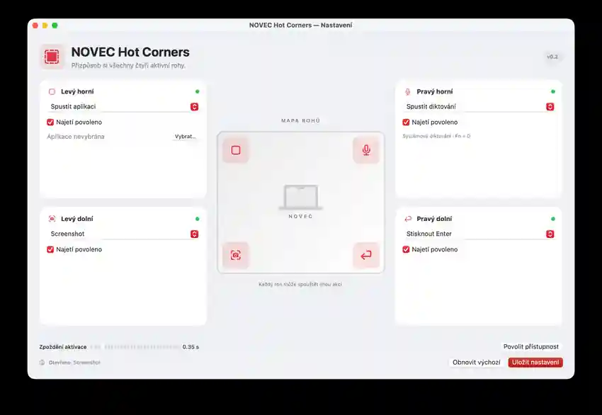

# NOVEC Mac Hot Corners

Native macOS app with a four-corner control panel and menu bar access. Version **0.2.0** adds a full graphical editor inspired by the classic Active Corners arrangement.



*Ukázka nastavení ve verzi 0.2 — pro každý roh lze vybrat jinou akci.*

## Four corners — your rules

Choose an action separately for each screen corner in **NOVEC Hot Corners → Nastavení aktivních rohů** in the menu bar:

- Mission Control, show application windows, or show desktop (native macOS actions)
- Screenshot toolbar, system-wide Dictation using **Fn + D**, or Enter
- Any keyboard shortcut such as `cmd+shift+5`, `ctrl+up`, or `fn+d`
- A command executed visibly in macOS Terminal
- An installed application selected with the file chooser
- Disable a corner individually

The settings GUI includes a visual screen diagram, enable switches and adjustable hover delay. Actions are saved locally and apply immediately. The physical MacBook **F5 microphone key is not changed**.

The default mapping remains:

| Corner | Default |
|---|---|
| Top-left | Mission Control |
| Top-right | macOS Dictation (Fn + D) |
| Bottom-left | Screenshot |
| Bottom-right | Return / Enter |

## Install

1. Open [Releases](https://github.com/jnovec/novec-mac-hot-corners/releases/latest).
2. Download **NOVEC-Hot-Corners-v0.2.0-macOS-universal.zip** — **not** GitHub's automatically generated source ZIP.
3. Extract the whole ZIP, then open `install.command` next to `NOVEC Hot Corners.app`.
4. Allow the app in System Settings → Privacy & Security → Accessibility, and enable Dictation in Keyboard settings.
5. The GUI opens on first launch. Afterward, open settings anytime from the **NOVEC icon in the macOS menu bar**.

The installer backs up any previous version, installs into `~/Applications`, starts the app and registers quiet autostart on GUI login. No n8n server, Docker or administrator access is required.

**Security and permissions:** The public CI release is ad-hoc signed, not signed with an Apple Developer ID and not notarized. On download macOS may require **Open Anyway** after you review and trust the package. Updates may require re-approving Accessibility. The optional Terminal action executes **only the command you explicitly enter**, with your current user permissions, and macOS may request permission to automate Terminal. Avoid untrusted commands.

## Building from source

```sh
xcrun swiftc -O Sources/*.swift -o novec-hot-corners
./novec-hot-corners --self-test
```

The [GitHub Actions workflow](https://github.com/jnovec/novec-mac-hot-corners/actions/workflows/build-release.yml) builds and tests for Apple Silicon (`arm64`) and Intel (`x86_64`) on GitHub's macOS runners, combines a universal binary, creates a local ad-hoc app signature, and attaches a ZIP and SHA-256 checksum to each `v*` GitHub Release.

## Implementation

- Native SwiftUI settings UI plus menu bar status item (AppKit)
- Preferences stored locally using UserDefaults
- Custom corner polling: 350 ms default hover dwell, one activation per visit, 2-second cooldown
- Multimonitor detection via `NSScreen`
- Local keyboard events using macOS Accessibility / CGEvent APIs
- Native desktop/workspace actions controlled through macOS Dock hot corners
- Log: `~/Library/Logs/NOVEC-HotCorners.log`

CI verifies compilation, architecture, signature and corner mapping but cannot simulate macOS GUI approval or external application behavior. Practical GUI and Terminal/Automation permissions should be validated on the target Mac.

This repository contains only the standalone NOVEC Mac Hot Corners app.
